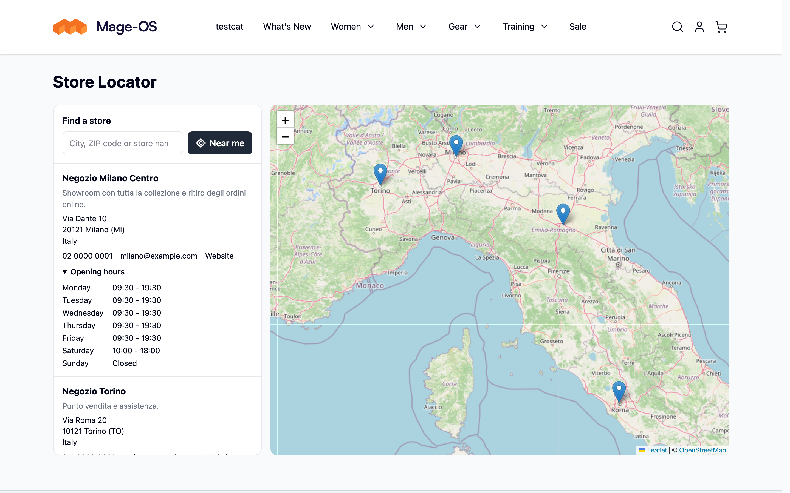
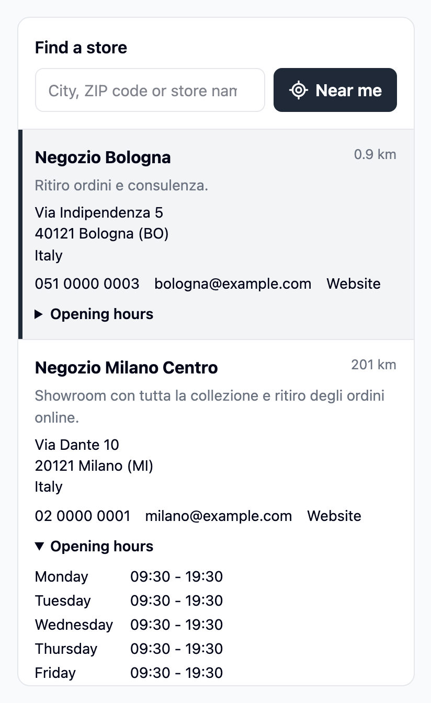
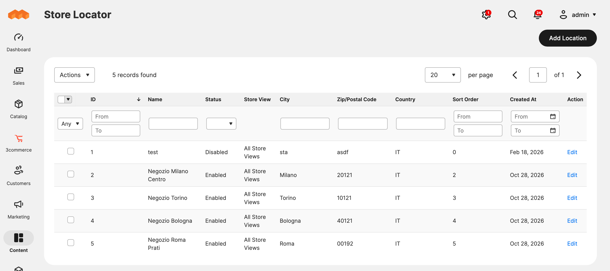
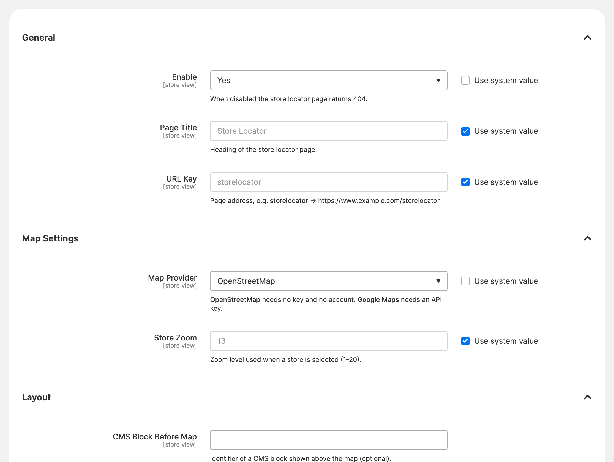

# Threecommerce_Storelocator: store locator for Magento 2 / Mage-OS with Google Maps or OpenStreetMap

A **store locator** page for Magento 2 and Mage-OS: list of your stores with a **Google Maps** or **OpenStreetMap** map (your choice, from the admin), search by city or postcode, "near me" and opening hours. Stores are managed from the admin.



**Compatibility:** Magento Open Source / Adobe Commerce 2.4.4 – 2.4.9 · Mage-OS 1.x / 3.x · PHP 8.1 – 8.4 · Themes: Luma, Hyvä, Breeze
**License:** free · **Current version:** see [Releases](../../releases)

## Features

- Map provider chosen from the admin: **Google Maps** (default) or **OpenStreetMap**. With OpenStreetMap you need no key and no account; Leaflet 1.9.4 is bundled in the module, no CDN.
- Server-rendered store list with only the **active** stores of the current store view, sorted by sort order and name.
- Search by city, postcode, address or name; **Near me** sorts stores by distance (needs the browser location permission).
- Per store: description, address, phones, email, website, social links, **opening hours** for each day, and a "Get directions" link (Google Maps or openstreetmap.org depending on the provider).
- Map loaded only when it scrolls into view; click on a store or marker centers the map and opens the info window.
- Vanilla JavaScript and plain CSS: works with Luma, Breeze and Hyvä. Colors and height are themable with the `--tc-storelocator-*` CSS variables.
- CSP whitelist included for Google Maps and OpenStreetMap tiles. Italian translation included.







## Requirements

- Magento Open Source / Adobe Commerce 2.4.4+ or Mage-OS
- PHP 8.1 – 8.4
- Package: `threecommerce/m2-base` (installed automatically by Composer)
- With Google Maps: an API key with *Maps JavaScript API* enabled (without a key the page still shows the store list)

## Installation

The package is distributed through our Composer repository at `repo.threecommerce.it`. Request the credentials from the [product page](https://www.threecommerce.it/store-locator-google-maps-magento-2?utm_source=github&utm_medium=readme&utm_campaign=magento2-store-locator), then:

```bash
composer config repositories.threecommerce composer https://repo.threecommerce.it
composer require threecommerce/m2-storelocator
bin/magento module:enable Threecommerce_Storelocator
bin/magento setup:upgrade
bin/magento cache:flush
```

## Configuration

Admin → **Stores → Configuration → Threecommerce Plugins → Store Locator** (or Content → Store Locator → Settings): enable, page title and URL key (default `/storelocator`), map provider, Google Maps key and Map ID, zoom, CMS blocks before and after the map, SEO. Stores are managed in **Content → Store Locator → Stores**.

## Documentation and support

- Product page: [threecommerce.it/store-locator-google-maps-magento-2](https://www.threecommerce.it/store-locator-google-maps-magento-2?utm_source=github&utm_medium=readme&utm_campaign=magento2-store-locator)
- [Changelog](CHANGELOG.md) (in Italian)
- Support and custom development: [threecommerce.it/contatti](https://www.threecommerce.it/contatti?utm_source=github&utm_medium=readme&utm_campaign=magento2-store-locator)

---

*This repository is the public showcase of the module. The source code is kept in a private repository.*
